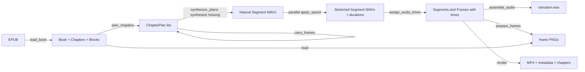

# Architecture

`book2video` is a batch pipeline with one deep scheduling core. EPUB parsing,
normalisation and illustration timing are pure modules; synthesis, time-stretch
and rendering sit behind narrow adapters. The container is the only runtime.

## Product invariants

These are not implementation details; a change that breaks one is a product
change and needs an ADR.

1. One MP4 per book. Illustrations only: no subtitles, no burned-in titles, no
   video clips.
2. 1920×1080, 16:9, aspect ratio preserved, static frames, hard cuts.
3. An image never appears before its chapter starts.
4. Cuts happen at the midpoint between two image anchors.
5. A chapter without illustrations reuses the previous chapter's last frame;
   before the first illustration the screen shows a neutral blank frame.
6. Headings and figure/table captions are read.
7. Tables are zoomed and their caption is read; a table holds for at least
   `--table-hold` seconds.
8. Sidebars are read in place with an opposite-gender voice.
9. A URL that needs a QR gets a spoken link sentence and a frame whose caption
   is the full URL. The QR frame is a normal frame with its own anchor and
   area of influence, not a fixed 15-second slot.
10. Appendices are appended to the tail of the same video file.
11. Speed is changed only after synthesis, by ffmpeg `atempo`.
12. Tera's stress output is accepted as-is.

## Data flow



`build.build` is the composition root. It owns the order of those calls and the
work directory, and nothing else. The backend is injected at the synthesis
seam, so tests can run the whole flow with a fake TTS.

## Modules

| Module | Interface | What it hides | Tests |
| --- | --- | --- | --- |
| `epub` | `load_book(path)`, `select_chapter(book, selector)` | ZIP/OPF spine reading, XHTML walking, block classification, front/back-matter heuristics, image usability | `test_epub` |
| `normalize` | `normalize_for_speech(text)`, `needs_qr`, `link_narration` | Russian number/date/unit expansion, Tera-unsafe symbols, URL decisions | `test_normalize` |
| `timeline` | `plan_chapters`, `carry_frames`, `assign_audio_times` | Segment construction, pauses, anchors, midpoint scheduling, minimum holds, blank frames | `test_timeline` |
| `speed` | `apply_speed(src, dst, speed)` | atempo filter construction, ffmpeg invocation, float32 intermediates | `test_speed` |
| `audio` | `synthesize_plans(backend, plans, work, speed, atempo_workers)`, `assemble_audio(plans, path)` | two-phase cache use, parallel atempo pool, per-segment measurement, loudness normalisation, pause insertion | `test_audio`, `test_build` |
| `render` | `prepare_frames`, `write_timeline`, `render` | image fitting, table drawing, ffmpeg concat, metadata/chapter files | `test_build` |
| `voices` | `TERA_VOICES`, `get_voice`, `opposite_gender` | voice catalogue and defaults | `test_voices` |
| `tts.tera` | `TeraBackend.synthesize(text, voice, out_path)` | model loading, stress markup, sentence chunking, chunk cache | `test_tts` |
| `build` | `build(epub, out, **options)` | orchestration and work-directory layout | `test_build` |

The **deep modules** are `timeline` and `epub`. Their interfaces are two or
three functions, while the implementation holds most of the product policy.
Keep them that way: new illustration rules belong in `timeline`, new content
rules in `epub`, not in `build` or `cli`.

## Seams and adapters

There are three real seams:

- **Synthesis** — `synthesize_plans` calls `backend.synthesize(text, voice,
  out_path)`. Production uses `TeraBackend`; `test_build` uses `FakeBackend`.
  The interface is intentionally duck-typed: no abstract base class until a
  second production backend exists.
- **Time-stretch** — `speed.apply_speed` is the only module that knows about
  ffmpeg's `atempo`. `audio` runs those calls in a thread pool; the rest of the
  pipeline sees durations.
- **Render** — `render.render` is the only module that composes the ffmpeg
  command line. Frame scheduling never depends on encoder details.

`Book.read(resource)` is the adapter between the EPUB archive and frame
preparation; it keeps ZIP access out of `render`.

## Timing rules

A `Segment` starts at `cursor + pause_before`; `cursor` advances by the
segment's measured duration plus `hold_after` (the extra time needed to meet a
minimum hold). A `Frame` gets an `anchor` from its Segment, or from the end of
the previous Segment when it has no caption. `_schedule_frames` then:

1. cuts the first frame in at the chapter start;
2. cuts every later frame at the midpoint between its anchor and the previous
   frame's anchor;
3. spreads a run of images that share one anchor evenly;
4. inserts a blank frame if the first real frame would start late;
5. enforces minimum holds and makes the last frame run to the chapter end.

`render._collect_entries` sorts frames across chapters and closes gaps, so the
screen is never blank between chapters.

## Work directory

```
work/
  audio/            ch04_0000.wav, ch04_0000_s1.200_at.wav, ...
  frames/           ch04_000.png, ...
  timeline.json     segments and frames with times
  frames.txt        human-readable frame plan
  metadata.txt      ffmpeg FFMETADATA1 with chapters
  narration.wav     mono 44.1 kHz PCM16
```

`audio/` is a cache: deleting it forces synthesis, keeping it makes re-renders
cheap. `frames/` is rebuilt on every run because frame indices shift when the
plan changes. `narration.wav`, `timeline.json`, `frames.txt` and `metadata.txt`
are derived and can be deleted safely.

## Known friction and deepening opportunities

Reviewed with the deletion test: would deleting the module concentrate
complexity, or merely move it?

| Candidate | Problem | Deepening | Strength |
| --- | --- | --- | --- |
| `build` composition root | It created `TeraBackend` itself, so the whole pipeline could only be tested with the real model. | Accept an injected `backend`; tests supply a fake. Implemented in `test_build`. | Strong (done) |
| `epub` heuristics | The heuristics are the largest and least formal part; a wrong classification silently drops a chapter. | Keep synthetic EPUB fixtures per rule (front matter, notes, appendix, image container) and add one when a real book breaks. | Worth exploring |
| `render` command assembly | The ffmpeg command is long but lives at one adapter seam; splitting it would add shallow modules without locality. | Keep as one function; test the observable MP4 contract, not the argument list. | Not recommended |
| `audio.synthesize_plans` | Two phases per run: sequential Tera synthesis, then a bounded pool of ffmpeg processes. | Keep the phases separate: Tera already uses its own threads, while atempo is pure subprocess waiting. Sharing one loop would keep ffmpeg idle until the last segment is synthesized. | Strong (done) |

**Top recommendation:** keep `timeline` pure and keep the injected synthesis
seam. Those two choices give the most leverage: a full build can be verified in
seconds without the model, and every scheduling rule is testable as data.
