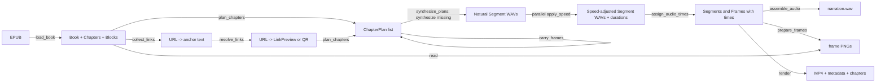

# Architecture

`book2video` is a batch pipeline with one deep scheduling core. EPUB parsing,
normalisation and illustration timing are pure modules; synthesis, time scaling
and rendering sit behind narrow adapters. The container is the only runtime.

## Product invariants

These are not implementation details; a change that breaks one is a product
change and needs an ADR.

1. One MP4 per book. Stills only: illustrations and link previews, no
   subtitles, no burned-in titles, no video clips.
2. 1920×1080, 16:9, aspect ratio preserved, static frames, hard cuts.
3. An image never appears before its chapter starts.
4. Cuts use the frame scheduler: every frame gets at least `--frame-hold`
   seconds when the chapter has room, otherwise all frames are shortened
   equally. A cut never crosses a chapter boundary and the mention is kept
   inside its own frame where possible.
5. A chapter without illustrations reuses the previous chapter's last frame;
   before the first illustration the screen shows a neutral blank frame.
6. Headings and figure/table captions are read.
7. Tables are zoomed and their caption is read; a table holds for at least
   `--frame-hold` seconds.
8. Sidebars are read in place with an opposite-gender voice.
9. Every external link except a footnote gets a spoken compressed URL and a
   frame. If a preview can be rendered, the frame shows the first page or
   first screen with a compact URL, a mini-QR and, for partial items, a status
   line. Otherwise it is a full QR frame. A failed preview never fails the
   build.
10. Appendices are appended to the tail of the same video file.
11. Speed is changed only after synthesis, by ffmpeg `atempo`.
12. Tera's stress output is accepted as-is.
13. There is no date on any frame.

## Data flow



`build.build` is the composition root. It owns the order of those calls and the
work directory, and nothing else. The backend is injected at the synthesis
seam, so tests can run the whole flow with a fake TTS.

## Modules

| Module | Interface | What it hides | Tests |
| --- | --- | --- | --- |
| `epub` | `load_book(path)`, `select_chapter(book, selector)` | ZIP/OPF spine reading, XHTML walking, block classification, front/back-matter heuristics, image usability | `test_epub` |
| `normalize` | `normalize_for_speech(text)`, `spoken_url(url)`, `link_narration(url)` | Russian number/date/unit expansion, Tera-unsafe symbols, compressed spoken URLs | `test_normalize` |
| `links` | `collect_links(chapters)`, `resolve_links(urls, cache, ...)`, `LinkPreview` | link policy, provider adapters, HTTP limits, PDF/image/site rendering, preview cache, offline mode, annotation text | `test_links` |
| `timeline` | `plan_chapters`, `carry_frames`, `assign_audio_times` | Segment construction, pauses, anchors, content and QR frames, minimum holds, mention preference, blank frames | `test_timeline` |
| `speed` | `apply_speed(src, dst, speed)` | atempo filter construction, ffmpeg invocation, float32 intermediates | `test_speed` |
| `audio` | `synthesize_plans(backend, plans, work, speed, atempo_workers)`, `assemble_audio(plans, path)` | two-phase cache use, parallel atempo pool, per-segment measurement, loudness normalisation, pause insertion | `test_audio`, `test_build` |
| `render` | `prepare_frames`, `write_timeline`, `render` | image fitting, table drawing, content footer with mini-QR, ffmpeg concat, metadata/chapter files | `test_build` |
| `voices` | `TERA_VOICES`, `get_voice`, `opposite_gender` | voice catalogue and defaults | `test_voices` |
| `tts.tera` | `TeraBackend.synthesize(text, voice, out_path)` | model loading, stress markup, sentence chunking, chunk cache | `test_tts` |
| `build` | `build(epub, out, **options)` | orchestration and work-directory layout | `test_build` |

The **deep modules** are `timeline`, `epub` and `links`. Their interfaces are a
few functions, while the implementation holds most of the product policy.
Keep them that way: new illustration rules belong in `timeline`, new content
rules in `epub`, new link policy in `links`, not in `build` or `cli`.

## Seams and adapters

There are four real seams:

- **Synthesis** — `synthesize_plans` calls `backend.synthesize(text, voice,
  out_path)`. Production uses `TeraBackend`; `test_build` uses `FakeBackend`.
  The interface is intentionally duck-typed: no abstract base class until a
  second production backend exists.
- **Time scaling** — `speed.apply_speed` is the only module that knows about
  ffmpeg's `atempo`. `audio` runs those calls in a thread pool; the rest of the
  pipeline sees durations.
- **Link resolution** — `build` collects URLs and passes them to
  `resolve_links`. Production uses the network adapters in `links`; an
  injected `link_resolver` lets tests supply previews without network access.
  A resolver returns `{url: LinkPreview}`; missing URLs stay QR frames.
- **Render** — `render.render` is the only module that composes the ffmpeg
  command line. Frame scheduling never depends on encoder details. Short books
  use one concat-filter pass; books above 96 frames are encoded in bounded
  chunks and joined by the concat demuxer, which keeps memory flat for
  illustrations-heavy books.

`Book.read(resource)` is the adapter between the EPUB archive and frame
preparation; it keeps ZIP access out of `render`.

## Timing rules

A `Segment` starts at `cursor + pause_before`; `cursor` advances by the
segment's measured duration. `assign_audio_times` then gives every `Frame` an
`anchor` from its Segment, or from the end of the previous Segment when it has
no caption. Block-level minimum holds are not inserted into the audio: the
frame scheduler uses the real narration length.

`_schedule_frames` works inside one chapter:

1. If the chapter is shorter than `frame_hold * frame_count`, all frames are
   shortened **equally**; no frame is privileged.
2. Otherwise start from the natural midpoint between neighbouring anchors and
   spread runs that share one anchor evenly.
3. Project the boundaries so every frame has at least `frame_hold` seconds.
4. Prefer to keep each mention inside its frame with at least half a hold
   after it; if that is impossible, make the smallest deviation. Surplus fills
   the natural midpoint area up to the chapter bounds.
5. The first frame cuts in at the chapter start and the last one runs to the
   chapter end, so a chapter with any frame has no gap.

Frames never cross a chapter boundary. `render._collect_entries` sorts frames
across chapters and closes the gap between chapters, so the screen is never
blank between chapters.

## Link previews

`links.collect_links` walks content blocks, ignores `footnote` blocks and
keeps one descriptive anchor per unique HTTP(S) URL. `links.resolve_links`
caches each URL under `<work>/links/<sha256(url)>/` (`preview.png` and
`meta.json`). A cached preview is used on every run; in `--offline-links` mode
the cache is the only source and a miss is a QR frame.

The adapters are:

| Input | Preview | Full or partial |
| --- | --- | --- |
| Google Docs / Sheets / Slides | PDF export, first page | full when one page/slide |
| `disk.yandex.ru` / `yadi.sk` | public-resources API, then PDF or image | PDF page count |
| `docs.yandex.ru` | embedded PDF, else screenshot | PDF page count, else site |
| generic PDF | first page via `pdftoppm` at 150 DPI | full when one page |
| generic image | the image, `contain`, never upscaled | always full |
| HTML | first viewport via Playwright, 1440×900 @2× | always partial |
| docx, archive, video, other | none | QR frame |

Every preview frame keeps a mini-QR of the full URL. A full item has no status
line; a partial one reports `стр. 1 из N`, `слайд 1 из N` or `первый экран`.
The spoken URL is compressed by `normalize.spoken_url` (domain plus up to four
meaningful path words); the annotation sentence comes from `LinkPreview`.

HTTP limits are 20 s, 50 MB and five redirects for HTTP(S) only. There are no
captcha or login heuristics and no SSRF checks: the EPUB is trusted, and
whatever was captured is shown. Any failure is a QR frame, never a build
failure.

## Work directory

```
work/
  audio/            <sha256>.wav, <sha256>_s2.000_at.wav, ...
  links/            <sha256>/{preview.png,meta.json}, one per URL
  frames/           ch04_000.png, ...
  tts/              <sha256>.wav, Tera chunk cache
  timeline.json     segments and frames with times and preview metadata
  frames.txt        human-readable frame plan
  metadata.txt      ffmpeg FFMETADATA1 with chapters
  narration.wav     mono 44.1 kHz PCM16
```

`audio/` and `links/` are caches: deleting `audio/` forces synthesis, deleting
`links/` forces preview resolution. Keeping them makes re-renders cheap.
`frames/` is rebuilt on every run because frame indices shift when the plan
changes. `narration.wav`, `timeline.json`, `frames.txt` and `metadata.txt` are
derived and can be deleted safely.

## Known friction and deepening opportunities

Reviewed with the deletion test: would deleting the module concentrate
complexity, or merely move it?

| Candidate | Problem | Deepening | Strength |
| --- | --- | --- | --- |
| `build` composition root | It created `TeraBackend` itself, so the whole pipeline could only be tested with the real model. | Accept an injected `backend`; tests supply a fake. Implemented in `test_build`. | Strong (done) |
| `epub` heuristics | The heuristics are the largest and least formal part; a wrong classification silently drops a chapter. | Keep synthetic EPUB fixtures per rule (front matter, notes, appendix, image container) and add one when a real book breaks. | Worth exploring |
| `render` chunking | Hundreds of still-image inputs exhausted the container's memory before encoding started. | Bound the number of inputs per ffmpeg pass and join the encoded parts with the concat demuxer; keep the observable MP4 contract. Implemented after the 416-frame book was killed by the OOM killer. | Strong (done) |
| `audio.synthesize_plans` | Two phases per run: sequential Tera synthesis, then a bounded pool of ffmpeg processes. | Keep the phases separate: Tera already uses its own threads, while atempo is pure subprocess waiting. Sharing one loop would keep ffmpeg idle until the last segment is synthesized. | Strong (done) |

**Top recommendation:** keep `timeline` pure and keep the injected synthesis
seam. Those two choices give the most leverage: a full build can be verified in
seconds without the model, and every scheduling rule is testable as data.
